# CST8911 Lab 4 — Alerts and Automation Accounts

**Student:** Samuel Vachon (041101891)  
**Course:** CST8911 — Intro to Cloud Computing

This lab configured an Azure Monitor CPU alert with a built-in VM stop action and used a custom Azure Automation runbook to deallocate a tagged VM. The runbook test completed successfully, and Azure confirmed deletion of the lab resource group.

## 1. Create the virtual machine

| Setting                                      | Configuration                                            |
| -------------------------------------------- | -------------------------------------------------------- |
| Resource group                               | `CST8911-Lab4-RG`                                        |
| Virtual machine                              | `cst8911-lab4-vm`                                        |
| Region                                       | East US 2                                                |
| Availability and security                    | No infrastructure redundancy required, Standard security |
| Operating system and architecture            | Ubuntu Server 24.04 LTS, x64                             |
| VM size                                      | Standard B2as v2                                         |
| Public inbound ports                         | None selected                                            |
| OS disk                                      | Standard SSD LRS                                         |
| NIC network security group and load balancer | None                                                     |
| VM tag                                       | `AutoShutdown=Enabled`                                   |

The lab specifies Standard B1s. This deployment used Standard B2as v2.

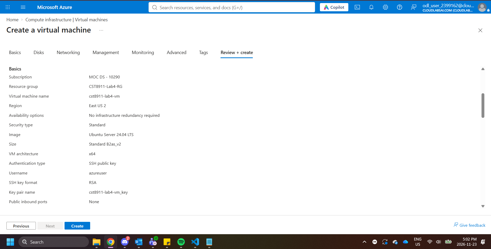

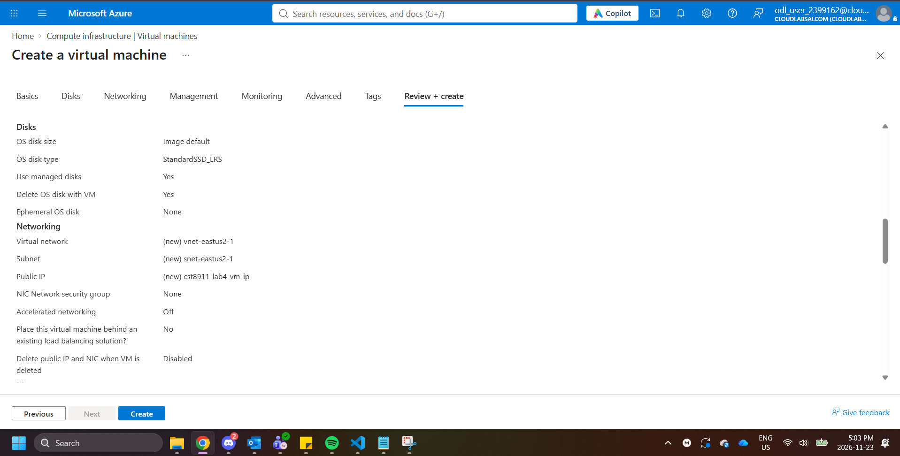

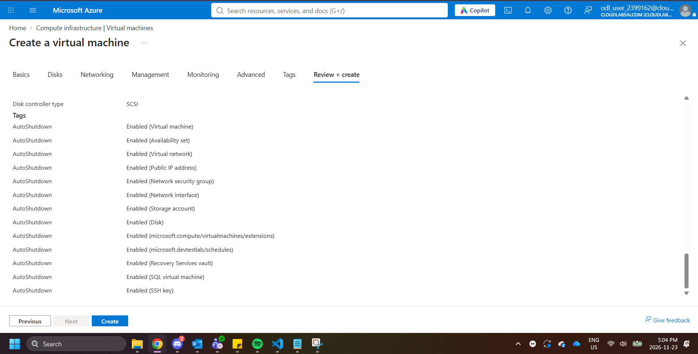

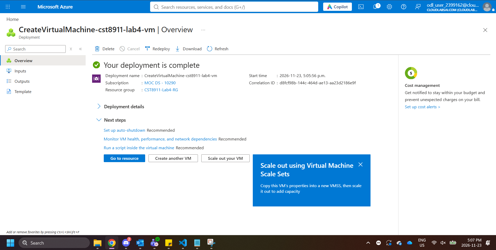

## 2. Configure the CPU alert and action group

I created `cst8911-lab4-high-cpu` with `cst8911-lab4-vm` as its scope. Azure Monitor checks the five-minute average of **Percentage CPU** every minute against a static threshold of **greater than 50%**.

I attached `cst8911-lab4-stop-vm`, an action group in **East US 2**, to the alert. Its `StopLabVM` action uses the built-in **Stop VM** runbook through `cst8911-lab4-auto`.

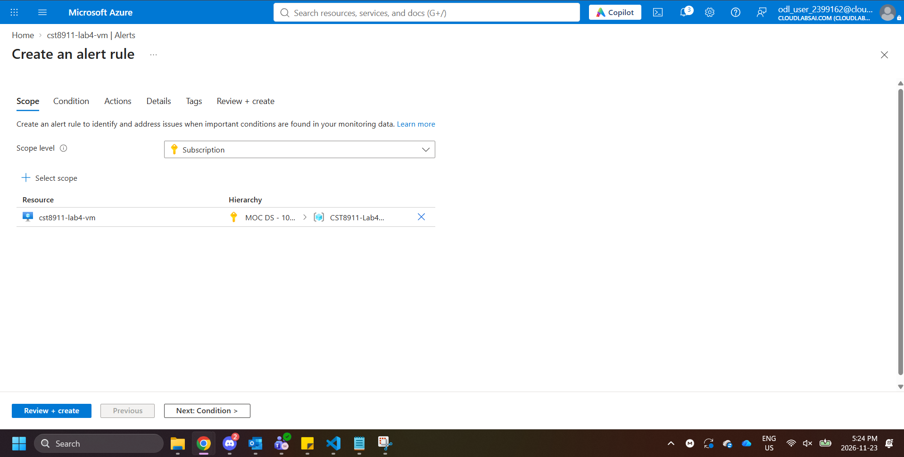

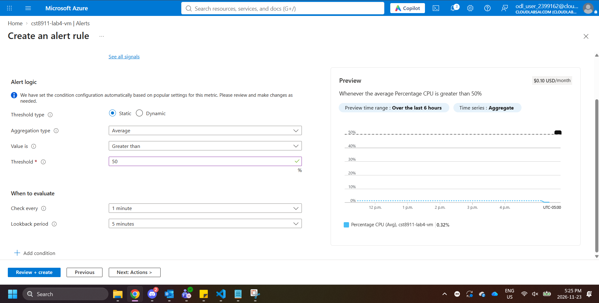

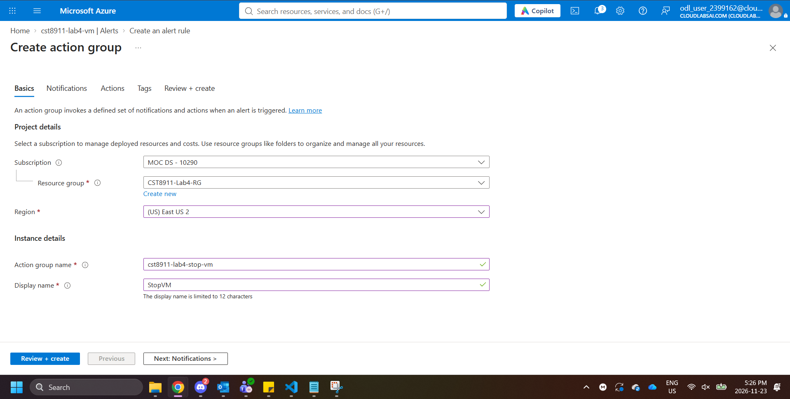

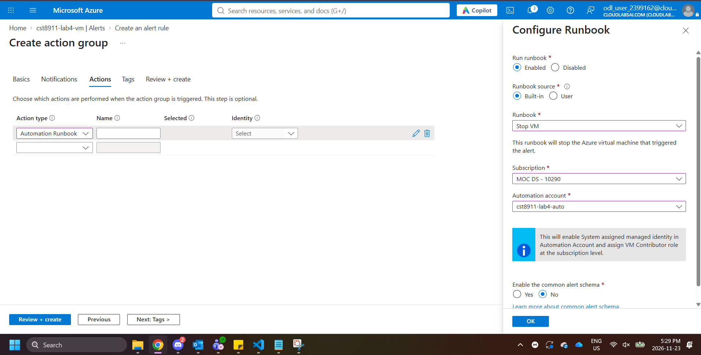

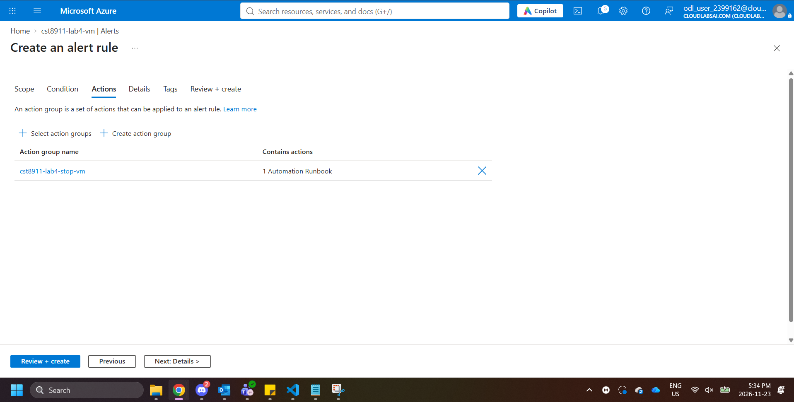

## 3. Create the Automation account

I created `cst8911-lab4-auto` in **East US 2** with a system-assigned managed identity. I assigned that identity the **Virtual Machine Contributor** role at the lab VM scope so it could read the VM and deallocate it.

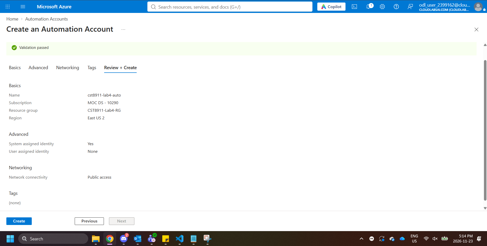

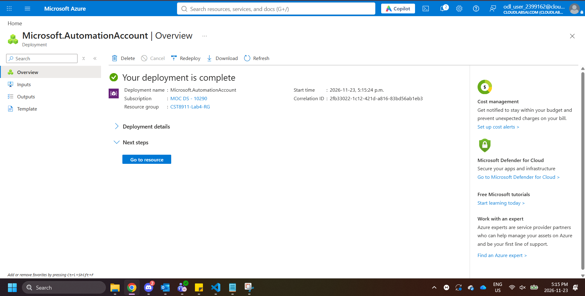

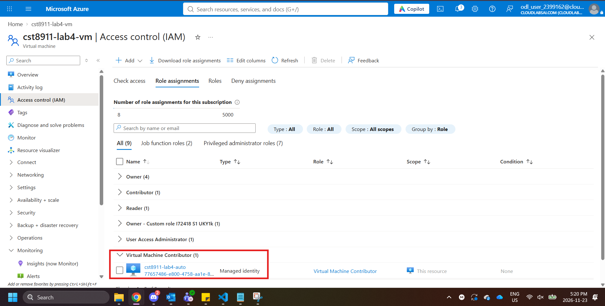

## 4. Create the PowerShell runbook

I created `Stop-TaggedLabVM` using the **PowerShell 5.1** runtime.

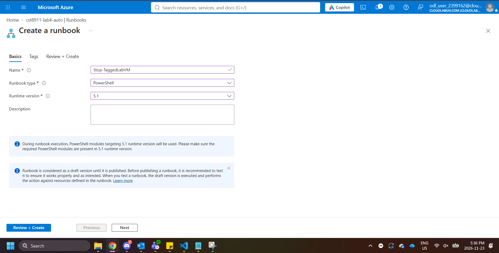

## 5. Test the tag-based shutdown

The runbook signs in using the Automation account's managed identity, looks up the lab VM, and checks the `AutoShutdown` tag. When the value is `Enabled`, it calls `Stop-AzVM` to deallocate the VM and then reads its power state.

The **Test pane** showed **Completed** and reported `Final VM status: VM deallocated`. The VM Overview independently showed **Stopped (deallocated)**. This result came from running the custom runbook through the Test pane.

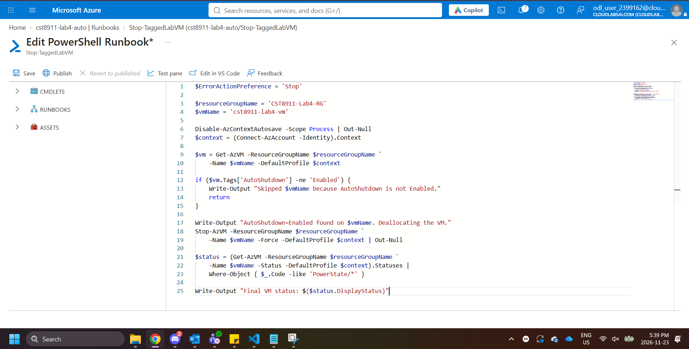

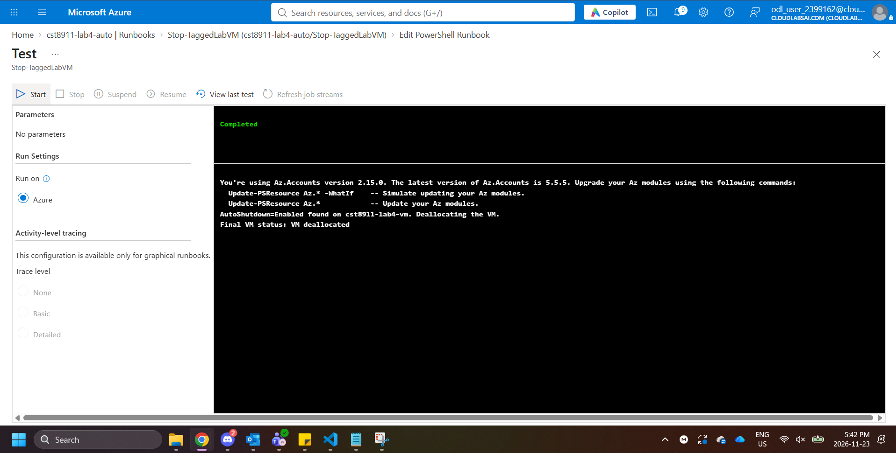

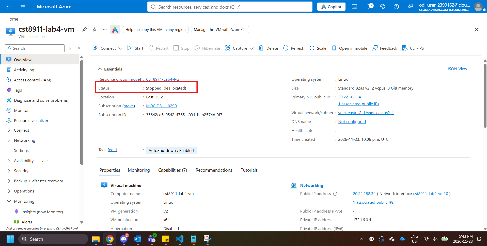

## 6. Delete the lab resources

I deleted `CST8911-Lab4-RG`. Azure displayed a successful deletion notification for that resource group.

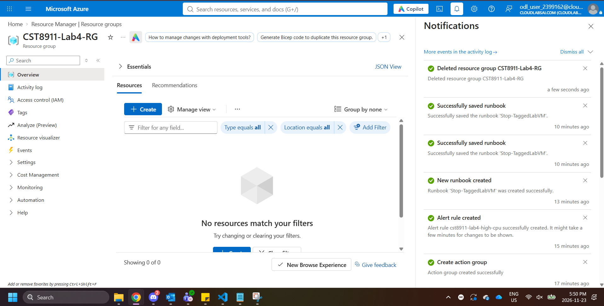
